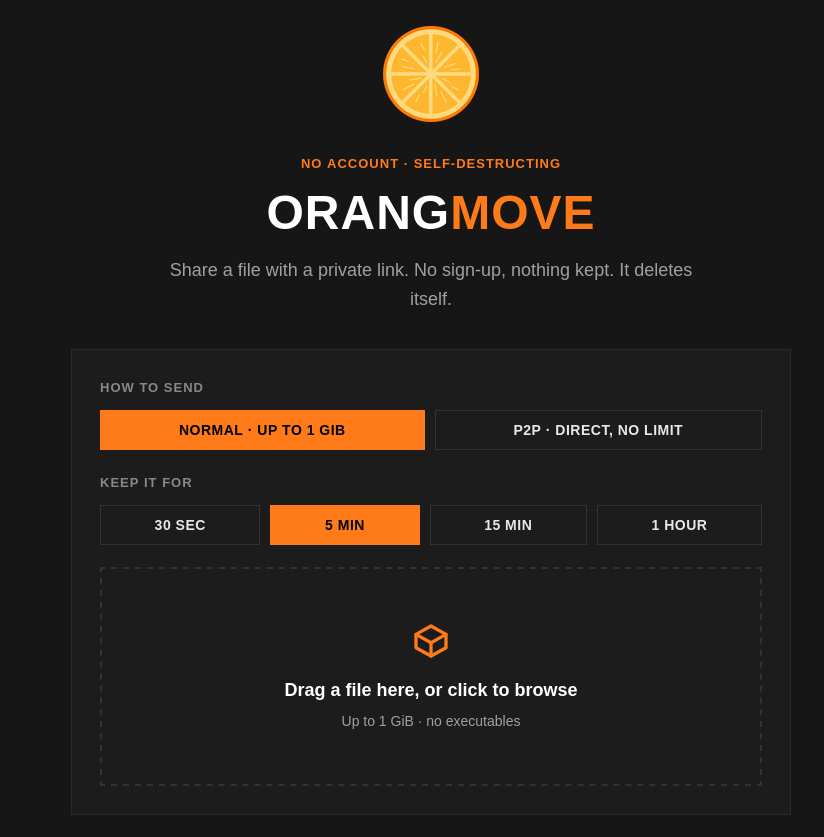

# OrangMove



Here it is: [move.oranges.lt](https://move.oranges.lt/)

No login file sharing MediaFire-like platform. Rust backend, React + Vite frontend.
Drop a file, pick how long to keep it, and share link. Files self destruct when their timer runs out.

## Run

**Dev:**
```bash
cd backend && cargo run                 # API on :8080
cd frontend && npm install && npm run dev   # UI on :5173 proxies /api to :8080
```

**Production (single server):**
```bash
cd frontend && npm install && npm run build 
cd backend && cargo run --release
```
Then open http://localhost:8080 and also run from repo root so server finds frontend/dist
Config via enviroment ORANG_STORAGE, ORANG_DB

## Security properties

- **Unguessable links** - 256-bit cryptographically-random tokens on URL is the secret sauce!
- **Inert bytes** - uploads are never executed, decompressed, or shelled out to. Fork/zip bombs just sit on disk :)))
- **No path traversal** - files are stored by token only; user filenames never touch a path.
- **1 GiB cap enforced live** - If you want more, use p2p.
- **Any file type accepted** - including executables. Safety comes from how bytes are served, not from guessing which ones are dangerous
- **Auto-expiry** - a background reaper deletes expired files + metadata every 5 sec

## Info 
- Thanks for support <br>
- Latest Version: 1.0 <br>
- Made by human with Love 🧡